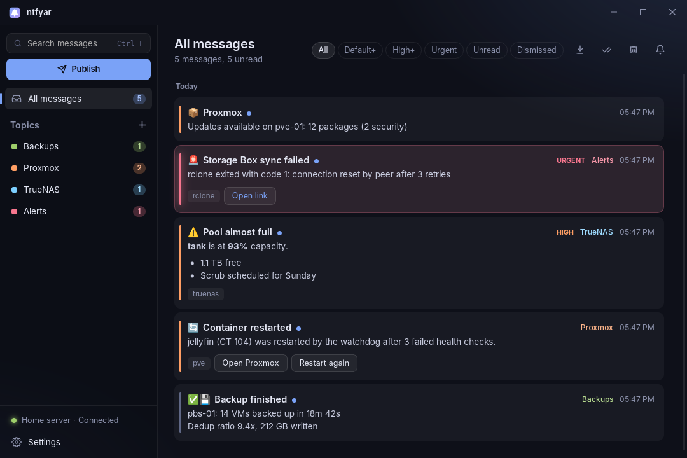

# ntfyar - A Windows 11 client for [ntfy](https://ntfy.sh)

It sits in the tray, shows native notifications, and keeps a searchable history.




> [!NOTE]
> I'm not a learned programmer, i've created this app with Claude. If you encouter problems, let me know and will do my best to fix them.

## Features

- **Native Windows notifications.** Title, message, tag emojis and image attachments are shown. ntfy action buttons (`view` / `http`) work straight from the toast.
- **Priorities.** Priority 5 notifications stay on screen with an alarm sound. Priority 4 stays longer. Priorities 1–2 are silent.
- **Tray app.** Starts with Windows (minimized). The tray icon changes for unread messages and for connection problems. Closing the window keeps the app running.
- **Several servers and topics.** Login can be none, username & password, or an access token. Passwords and tokens are stored in Windows Credential Manager, not in a file.
- **Topic sync with your ntfy account.** On servers where you log in, the topic list stays in sync with your ntfy account: topics added on the website or phone show up here.
- **History window** with search, per-topic views, priority and unread filters, Markdown rendering, image previews and in-app action buttons. Older messages the server still has can be loaded with one click, and are loaded automatically when you subscribe to a topic.
- **Dismiss with Undo.** × hides a message and offers Undo (also Ctrl + Z) for a few seconds. Dismissed messages stay available under the *Dismissed* filter. Permanent deletion is in the right-click menu and asks first.
- **Quick publish** from a global shortcut (default **Ctrl + Alt + N**), with title, priority, tags, click link, delay and Markdown.
- **Per-topic rules**: mute, minimum priority, keyword filter, sound on/off, colour.
- **Quiet hours** with an option to let urgent messages through.

## How to install

### Option A: download the installer

1. Open the [Releases](../../releases) page and download the latest `ntfyar_…_x64-setup.exe`.
2. Run it. Windows may show "Windows protected your PC" because the installer isn't code-signed: click **More info → Run anyway**.

### Option B: let GitHub build it (no tools on your PC)

1. Fork or clone this repository into your own GitHub account. (If you upload the files through GitHub's website instead, make sure the hidden `.github` folder comes along. The browser upload tends to skip it, and without it there is no build workflow.)
2. Open **Actions → Build installers → Run workflow**.
3. After about 10–15 minutes, download the `ntfyar-windows` artifact. It contains the `…-setup.exe` (and an `.msi`).

### Option C: build on your Windows PC

1. Install [Rust](https://rustup.rs) with the default MSVC toolchain, the Visual Studio C++ Build Tools with the **Desktop development with C++** workload, and [Node.js LTS](https://nodejs.org).
2. In this folder:
   ```
   npm install
   npm run build
   ```
3. The installer is at `src-tauri\target\release\bundle\nsis\ntfyar_0.1.0_x64-setup.exe`.

`npm install` is only needed once per folder. The first build takes several minutes, later ones are much faster. For development, `npm run dev` starts the app straight from the source.

> **Install it with the setup.exe** rather than running the bare `.exe`. Windows only shows toasts for apps registered through the installer's Start menu shortcut.

## First run

1. **Add server**: enter your server URL, e.g. `https://ntfy.example.com`. Under **Login**, pick *None* unless your server requires a username/password or token. **Test connection** tells you whether it works, and also whether your topics need a login.
2. **Subscribe to a topic**: use the same topic name you publish to. If you log in, the topics from your ntfy account are added automatically.
3. Send a test: `curl -d "Hello" https://ntfy.example.com/yourtopic`

ntfy only keeps messages for 12 hours by default. To load older history, raise `cache-duration` (and set a `cache-file`) on the server.

## Where things are stored

`%APPDATA%\app.ntfyar.desktop\` holds `config.json` (settings) and `history.json` (messages). Passwords and tokens are in Windows Credential Manager under *Generic Credentials*, named `<server-id>.ntfyar`. If Windows refuses to store them there, they go into `secrets.json` in the same folder, readable only by your user.

## Project layout

```
ui/                 the interface (plain HTML/CSS/JS, no build step)
  index.html app.js   main window: history + settings
  publish.html        quick publish window
  common.js           shared helpers (menus, toasts, formatting)
  styles.css          styles for both windows
src-tauri/src/
  lib.rs            app setup, tray, windows, commands
  ntfy.rs           streaming subscriptions, reconnect/catch-up, publish, actions
  sync.rs           topic list sync with the ntfy account
  notify.rs         notification rules + Windows toasts
  swca.rs           window transparency and blur on Windows
  config.rs         settings + credential storage
  history.rs        message history
  emoji.rs          ntfy tag → emoji mapping
```
